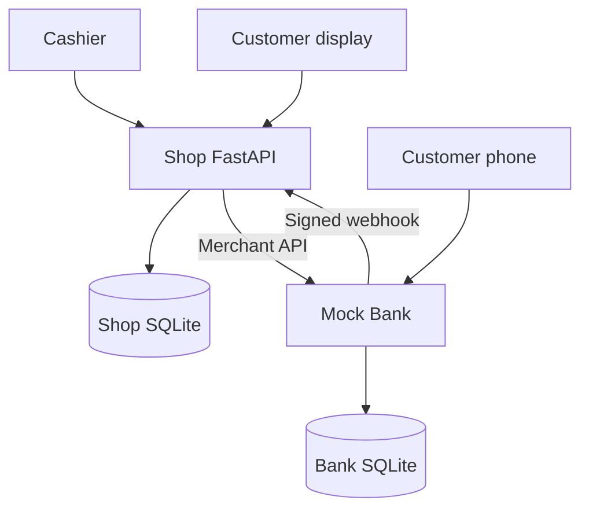
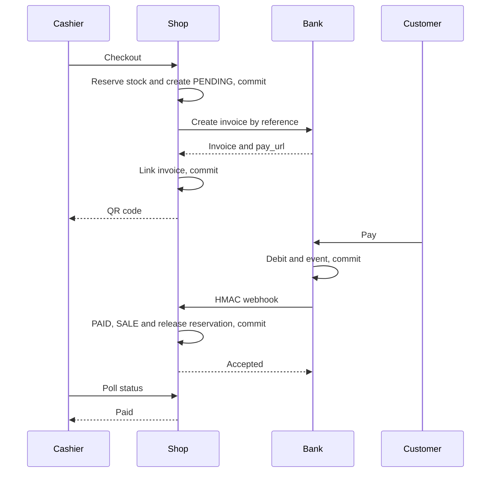
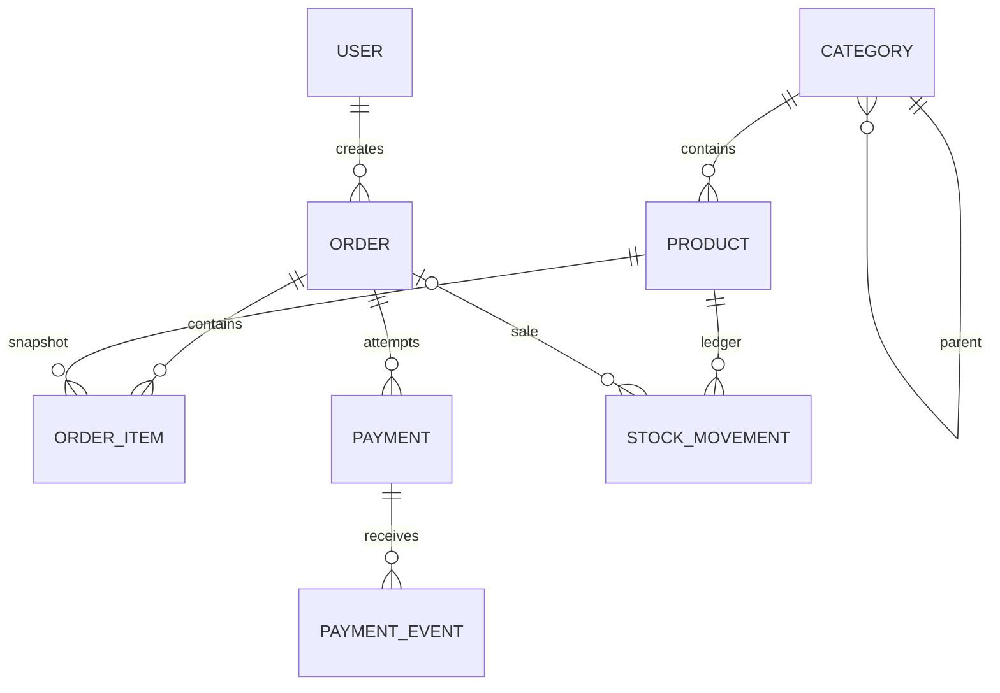
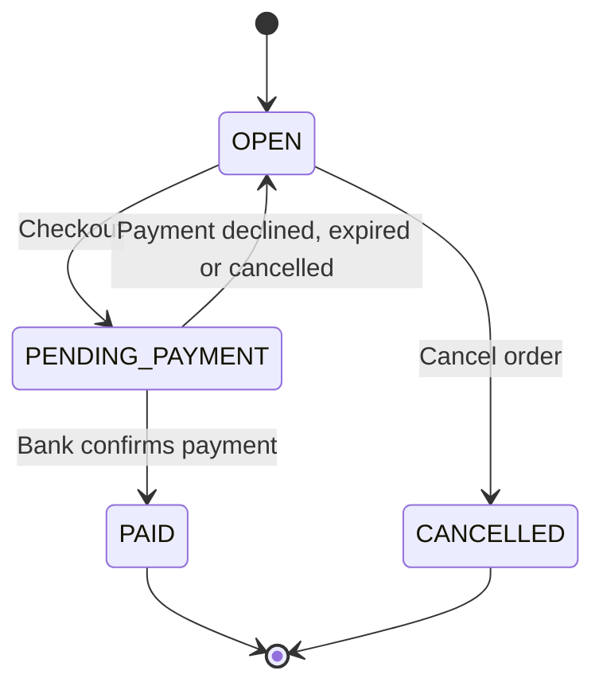

# QR Mini-Market

A complete educational mini-market: product catalog, cashier interface, customer display, QR payments through a separate Mock Bank, printable receipts, an admin panel, and reports. The Russian-language interface works without a CDN. No real money or card details are used; receipts are not fiscal documents.

Stack: Python 3.11+, FastAPI, SQLAlchemy 2, Pydantic 2, Alembic, SQLite/WAL, Jinja2, and plain JavaScript. Tested environment: Linux / Python 3.12.14. Direct dependency versions are pinned in the requirements files. Both services run independently and communicate exclusively over HTTP. Complete file contents are also available in [docs/SOURCE_CODE.md](docs/SOURCE_CODE.md), without abbreviations.

## Quick Start — Windows PowerShell

Run all commands from the extracted `qr-mini-market` directory.

```powershell
py -3 -m venv .venv
.\.venv\Scripts\python.exe -m pip install -r requirements-dev.txt
.\.venv\Scripts\python.exe -m app.setup_env
.\.venv\Scripts\python.exe -m alembic upgrade head
.\.venv\Scripts\python.exe -m app.seed
.\.venv\Scripts\python.exe -m mock_bank.seed
.\.venv\Scripts\python.exe -m app.create_user --username admin --role ADMIN
```

Enter your own password twice: 12–128 characters. To create a separate cashier account, repeat the command with `--username cashier --role CASHIER`.

First terminal — bank:

```powershell
.\.venv\Scripts\python.exe -m uvicorn mock_bank.main:app --host 0.0.0.0 --port 8001 --no-access-log
```

Second terminal — shop:

```powershell
.\.venv\Scripts\python.exe -m uvicorn app.main:app --host 0.0.0.0 --port 8000 --no-access-log
```

## Quick Start — Linux / macOS

```bash
python3 -m venv .venv
.venv/bin/python -m pip install -r requirements-dev.txt
.venv/bin/python -m app.setup_env
.venv/bin/python -m alembic upgrade head
.venv/bin/python -m app.seed
.venv/bin/python -m mock_bank.seed
.venv/bin/python -m app.create_user --username admin --role ADMIN
```

In the first terminal:

```bash
.venv/bin/python -m uvicorn mock_bank.main:app --host 0.0.0.0 --port 8001 --no-access-log
```

In the second terminal:

```bash
.venv/bin/python -m uvicorn app.main:app --host 0.0.0.0 --port 8000 --no-access-log
```

`app.setup_env` creates `.env` with three independent random secrets and does not overwrite an existing file. If `.env` was previously created from a template with empty fields, fill in the secrets manually. There are no default user accounts. Running the seed commands again adds missing demo records while preserving modified prices, stock quantities, and bank balances.

Open:

| Page | Purpose |
| --- | --- |
| [Cashier](http://127.0.0.1:8000/cashier) | Login, scanning, search, orders, and QR payments |
| [Customer display](http://127.0.0.1:8000/display/main) | Current order for terminal `main`, QR code, and payment result |
| [Price checker](http://127.0.0.1:8000/price-check) | Public product search without creating an order |
| [Admin panel](http://127.0.0.1:8000/admin) | Catalog, stock, and reports; ADMIN role required |
| [Shop health](http://127.0.0.1:8000/health) | Shop database availability |
| [Bank health](http://127.0.0.1:8001/health) | Bank database availability |

To stop the services, press Ctrl+C in both terminals. Data remains in the SQLite files. `/health` checks the database connection, but not migration completeness or the availability of the other service.

## Demo Scenario

1. Log in to the cashier interface using the account you created, then open `/display/main` in a second tab.
2. Add three products sold by piece and one product sold by weight. For a weighted product, enter a whole number of grams, such as 350. Search supports case-insensitive Cyrillic text; the scanner enters an EAN followed by Enter.
3. Click “Proceed to payment.” A QR code and a server-provided timer appear on the customer display. In development mode, a text link to the bank is also available.
4. Open the link, select Aidos, and pay. After the next polling request, the interface shows the successful payment and a printable receipt becomes available. Stock is deducted once, and the reservation is released.
5. Create an order exceeding 1,000 ₸ and select Aliya. The payment is declined due to insufficient funds; the order can be edited and paid again.
6. To test expiration, set `PAYMENT_TTL_SECONDS=30` in `.env`, restart the shop, and create a new QR code. The bank marks the invoice as EXPIRED; the shop releases the reservation after confirmation from the bank.
7. Cancelling a payment returns the order to OPEN. Cancelling the entire order closes it as CANCELLED.

The seed contains 27 categories and 47 products, including weighted products, low-stock products, and one inactive product. Demo accounts: Aidos — 500,000 ₸, Aliya — 1,000 ₸, Dana — 0 ₸. Their balances change when payments are made and are not reset by running the seed again.

## Docker Compose

Create `.env` using `python -m app.setup_env`. This command requires only Python; no additional dependencies are needed. Then run:

```bash
docker compose up --build -d
docker compose exec shop python -m app.create_user --username admin --role ADMIN
docker compose ps
docker compose logs -f
```

These commands are the same in PowerShell and Bash. The shop container applies migrations and runs its seed before starting; the bank container creates its own schema and runs its seed. The containers run as UID 10001 and store their databases in separate named volumes: `shop_data` and `bank_data`.

```bash
docker compose down
```

Stopping the containers preserves the volumes. The Dockerfile, Compose configuration, health checks, and entrypoint were prepared and statically checked. The image was not built in the verification environment because Docker was unavailable. The first launch requires access to the image registry and Python packages.

## Phone and Local Network

Your phone and computer must be connected to the same local network. Find the computer’s IPv4 address using `ipconfig` on Windows or the network settings on macOS/Linux. Set, for example, `BANK_PUBLIC_URL=http://192.168.1.50:8001` in `.env`, then restart the bank. QR codes for new invoices will point to this address.

On the phone, open the customer display at `http://192.168.1.50:8000/display/main`. On a phone, `127.0.0.1` refers to the phone itself. In Windows Firewall, allow incoming TCP connections on ports 8000 and 8001 for private networks. Client isolation on guest Wi-Fi networks may prevent connections.

`BANK_BASE_URL` is the bank address used by the shop server. For a normal local launch, keep localhost; Compose automatically sets it to `http://mock_bank:8001`. `SHOP_WEBHOOK_URL` is used by the bank to send callbacks; Compose sets it to `http://shop:8000/api/v1/webhooks/mock-bank`. `BANK_PUBLIC_URL` must always be accessible from the customer’s browser.

## Configuration

`.env` is loaded from the project root; process environment variables take precedence. Restart the relevant service after making changes.

| Variable | Default / purpose |
| --- | --- |
| `APP_ENV` | `development`; also supports `test` and `production` |
| `DATABASE_URL` | `sqlite:///./shop.db` |
| `BANK_DATABASE_URL` | `sqlite:///./mock_bank.db` in the template |
| `CURRENCY` | Only `KZT` |
| `TIMEZONE` | `Asia/Almaty`; database timestamps are always UTC |
| `PAYMENT_PROVIDER` | `mock_bank`; FakeProvider is injected only in tests |
| `PAYMENT_TTL_SECONDS` | 300; range: 1–86400 |
| `PAYMENT_EXPIRY_GRACE_SECONDS` | 30; a non-negative integer |
| `BANK_BASE_URL` | `http://127.0.0.1:8001`; an HTTP(S) origin without credentials |
| `BANK_PUBLIC_URL` | Address encoded in QR codes, usually localhost or a LAN IP |
| `SHOP_WEBHOOK_URL` | `http://127.0.0.1:8000/api/v1/webhooks/mock-bank` |
| `BANK_MERCHANT_API_KEY` | Required merchant API key, identical in both services |
| `WEBHOOK_SECRET` | Required shared HMAC secret |
| `SECRET_KEY` | Required separate JWT signing key for the shop |
| `ACCESS_TOKEN_EXPIRE_MINUTES` | 60; a positive number of minutes |
| `MERCHANT_NAME` | Shop name displayed on the bank page |

Each secret must contain at least 32 characters, without whitespace or placeholder values. The generator uses 48 random bytes per value. Secrets are not included in the archive. In `production`, cookies receive the Secure attribute, so browser login requires HTTPS. Compose is intended for local demonstrations; a TLS proxy must be configured separately.

## API and Permissions

All shop business endpoints use the `/api/v1` prefix. `{id}` refers to a UUID `public_id`, not an internal Integer ID. Lists use `{items, total, limit, offset}`, with a limit of 1–100. The machine-readable schema is available at `/openapi.json`; Swagger/ReDoc are disabled, and no CDN is required.

| Method and path after `/api/v1` | Access | Purpose |
| --- | --- | --- |
| `POST /auth/login` | Public | JSON username/password, JWT, and cookies |
| `GET /auth/me`, `POST /auth/logout` | Authenticated user | Current profile and logout |
| `GET /categories` | CASHIER/ADMIN | Category list |
| `POST /categories`, `PATCH/DELETE /categories/{id}` | ADMIN | Create, update, and deactivate categories |
| `GET /products`, `GET /products/{id}` | CASHIER/ADMIN | Catalog and product details |
| `GET /products/by-barcode/{barcode}` | CASHIER/ADMIN | Exact EAN lookup |
| `POST /products`, `PATCH/DELETE /products/{id}` | ADMIN | Create, update, and soft-delete products |
| `POST /products/{id}/stock-adjustments` | ADMIN | `{delta, reason: RESTOCK or ADJUSTMENT}` |
| `POST /orders`, `GET /orders`, `GET /orders/{id}` | CASHIER/ADMIN | Create, list, and view orders |
| `POST /orders/{id}/items` | CASHIER/ADMIN | `{barcode or product_id, quantity}` |
| `PATCH/DELETE /orders/{id}/items/{item_id}` | CASHIER/ADMIN | Update quantity or remove an item |
| `POST /orders/{id}/checkout` | CASHIER/ADMIN | Reserve stock and create a bank invoice |
| `POST /orders/{id}/cancel` | CASHIER/ADMIN | Cancel an order through bank cancellation |
| `GET /orders/{id}/receipt` | CASHIER/ADMIN | Paid-order receipt snapshot |
| `GET /payments/{id}`, `GET /payments/{id}/qr.png` | Public, by UUID | Payment status and QR code |
| `POST /payments/{id}/refresh`, `POST /payments/{id}/cancel` | CASHIER/ADMIN | Reconcile or cancel a payment |
| `POST /webhooks/mock-bank` | HMAC signature | Bank notification |
| `GET /public/products`, `GET /public/categories` | Public | Active catalog and availability without exact stock quantities |
| `GET /public/terminals/{terminal_code}/display` | Public | Current order, QR code, timer, and result |
| `GET /reports/sales` | ADMIN | Sales by day, category, and product |
| `GET /reports/low-stock` | ADMIN | Low available stock |
| `GET /reports/payments-needing-review` | ADMIN | Payments marked `needs_review` |

`GET /products` accepts `q`, `barcode`, `category_id`, `include_subcategories`, `is_active`, `limit`, and `offset`. Without `is_active`, the authenticated API also returns inactive products; the public API returns only available products. `GET /orders` supports filtering by `terminal_code` and `status`. The sales report accepts inclusive `date_from` and `date_to` values covering no more than 366 days. When dates are omitted, it uses the period from the beginning of the current month through the current local date.

The bank uses its own origin:

| Bank method and path | Access |
| --- | --- |
| `POST /api/merchant/invoices` | Bearer BANK_MERCHANT_API_KEY; idempotent by merchant_reference |
| `GET /api/merchant/invoices/{id}` | Merchant Bearer |
| `POST /api/merchant/invoices/{id}/cancel` | Merchant Bearer |
| `GET /pay/{token}` | Customer payment page |
| `GET /api/pay/{token}` | Invoice and demo account selection |
| `POST /api/pay/{token}` | Payment, JSON `{account_id: UUID}` |
| `POST /api/pay/{token}/cancel`, `/decline` | Cancellation / simulated decline |
| `GET /health` | Database connection check |

Shop errors use this format:

```json
{"error":{"code":"INSUFFICIENT_STOCK","message":"...","details":{}}}
```

Invalid data returns 422; authentication/authorization errors return 401/403; missing resources return 404; conflicts return 409; expired QR codes return 410; and an unavailable bank returns 503. Validation errors and unexpected errors do not expose submitted secrets.

API clients send `Authorization: Bearer <access_token>`. The browser uses an HttpOnly cookie and an `X-CSRF-Token` header taken from the `csrf_token` cookie for POST/PATCH/DELETE requests. JWT validation checks the issuer, audience, signature, and expiration. The user’s role and active status are read from the database on every request. Logout deletes cookies; a previously issued bearer token remains valid until it expires or the user is deactivated.

## Money Calculations and Data

- Monetary values are stored as whole tiyn: 1 ₸ = 100 tiyn. A PIECE price is per item; a KG price is per kilogram. KG quantity is a whole number of grams.
- PIECE: `price_minor * quantity`. KG: `(price_minor * quantity + 500) // 1000`. Each line is rounded once, with half a tiyn rounded upward.
- Repeated scans increase the total quantity and recalculate the line using the price snapshot. Catalog changes do not modify existing orders.
- Zero prices are allowed, but an order with a zero total cannot be paid. API prices and totals are limited to `2**53 - 1` tiyn to preserve exact JSON values in browsers; the database uses BigInteger. Report totals are additionally provided as the exact string `revenue_minor_text`.
- Quantities are limited to `2**31 - 1`. The database prohibits negative stock, reservations exceeding stock, and fractional quantities. Adjustments cannot reduce stock below the reserved quantity.
- A product’s unit cannot be changed after creation. Deactivating a category hides products in its descendant categories while preserving history. A category cannot be moved into its own subtree.
- EAN-8/EAN-13 codes are validated using their check digit. Demo codes consist of `200` + a nine-digit sequence number + a check digit. These are internal educational codes.
- OrderItem stores the product name, EAN, unit, price, and line total. Report categories come from the current catalog; the model does not include a category snapshot.

## Payments and Failure Recovery

Checkout has three phases: a short transaction reserves all items and creates a PENDING payment; an HTTP request creates a bank invoice; a separate transaction saves the response. If any item has insufficient stock, the entire first phase is rolled back. Each terminal may have only one OPEN/PENDING_PAYMENT order, and each order may have only one PENDING payment. Partial unique indexes also enforce these constraints.

Repeated checkout requests return the same payment. Invoice creation uses a persisted 30-second lease, preventing parallel requests from starting multiple outbound attempts. While another request is obtaining the invoice, `pay_url` may be null; the interface continues polling. The HTTP timeout is 10 seconds.

A confirmed connection failure on the first attempt allows the reservation to be released and the order to return to OPEN. A timeout, a lost response, or a retry after an uncertain outcome preserves PENDING and the reservation. Recovery uses the same merchant_reference. Stock must not be released simply because the shop did not receive a response: the bank may already have accepted the payment.

The bank saves the final status, debit, bank_transaction, and stable event_id in one transaction. Webhook delivery begins after commit. Events and delivery attempts are persisted in the database. The first attempt is immediate, followed by retries after 1, 5, and 25 seconds for network failures or 5xx responses. Permanent 4xx responses and redirects stop delivery. After retries are exhausted, the shop can still reconcile the result through the merchant API.

HMAC-SHA256 is calculated over `timestamp + "." + raw_body`; the allowed time difference is 300 seconds. An invalid signature does not create a PaymentEvent. A valid event and its effects on the payment, order, reservation, and ledger are committed together. Duplicate events do not deduct stock again. An early notification received before invoice_id is saved waits for the invoice to be linked. Incorrect data is saved for review, returns 422, and does not confirm payment.

Cancellation is performed in the bank first. If the bank has already received the money, the shop confirms the sale and returns ALREADY_PAID. Expiration is also reconciled with the bank; the local timer does not change the status on its own. Approximately every 15 seconds, a background task checks overdue PENDING payments after the grace period and unfinished invoice creation attempts. The “Check payment” button performs the same reconciliation immediately.

A late successful result for a locally FAILED/EXPIRED/CANCELLED payment sets `needs_review` and `review_reason=late_success`; history is not rewritten. Automatic refunds are not implemented. An administrator sees the record in the report and reviews it manually.

## Architecture





Shop ER diagram; bank models are stored in a separate database:





| Payment status | Allowed next status | Result |
| --- | --- | --- |
| PENDING | SUCCEEDED | Order becomes PAID; stock and reservation decrease; SALE recorded |
| PENDING | FAILED / EXPIRED / CANCELLED | Order becomes OPEN; reservation released |
| SUCCEEDED | None | Duplicates have no additional effect |
| FAILED / EXPIRED / CANCELLED | None | Late payment is flagged for review |

Main directories: `app/core` — settings/money/EAN; `app/db` — transactions and UTC; `app/models`, `schemas`, `services`, `routers`; `app/providers` — bank interface; `app/templates`, `static` — UI; `mock_bank` — independent bank; `migrations` — shop schema; `tests` — unit, integration, and end-to-end tests.

## Verification

Windows PowerShell:

```powershell
.\.venv\Scripts\python.exe -m pytest -q --cov=app.services --cov=mock_bank.service --cov=mock_bank.notifier --cov-report=term-missing --cov-fail-under=80
.\.venv\Scripts\python.exe -m ruff check .
.\.venv\Scripts\python.exe -m ruff format --check .
.\.venv\Scripts\python.exe -m alembic check
```

Linux / macOS:

```bash
.venv/bin/python -m pytest -q --cov=app.services --cov=mock_bank.service --cov=mock_bank.notifier --cov-report=term-missing --cov-fail-under=80
.venv/bin/python -m ruff check .
.venv/bin/python -m ruff format --check .
.venv/bin/python -m alembic check
```

Tests use temporary databases and their own settings; they do not require a populated `.env` file or running servers. `alembic check` requires a configured, up-to-date working database. The current verification report is available in [docs/VERIFICATION.md](docs/VERIFICATION.md). The known Starlette warning relates to the required use of httpx with TestClient; it is not suppressed by a filter.

Tests cover weight calculations, EAN validation, schema constraints and migrations, Cyrillic search, price snapshots, competition for the last stock item, concurrent checkout, atomic rollback, HMAC and retries, lost bank responses, early webhooks, incorrect amounts and late success, roles/CSRF, reports, and the complete two-service HTTP flow.

## Migrations, Operation, and Limitations

The shop creates tables using `alembic upgrade head`; the current head is `0002_commerce`. Do not edit migrations that have already been applied. `downgrade base` deletes data and is not required for startup. Upgrade, downgrade, re-upgrade, and metadata consistency have been tested. The bank uses its own `create_all` for the initial demo schema; changing an already installed bank schema will require a separate migration.

SQLite uses foreign_keys ON, WAL, busy_timeout 5000, and explicit transactions. Writes use BEGIN IMMEDIATE with bounded retries when locked. HTTP requests are never made inside business transactions. PostgreSQL uses conditional UPDATE statements, row locks, and retries for serialization failures/deadlocks; migration SQL was compiled offline. A PostgreSQL server was not tested. To use one, install `psycopg[binary]` separately and use `postgresql+psycopg://...`.

Logs record transitions, provider errors, and rejected signatures without Authorization headers, passwords, or secrets. Startup commands disable access logging so payment URLs do not appear in ordinary request logs. SQL statements or tracebacks containing original parameters are not exposed to clients.

This is a single-shop demonstration without fiscal receipt processing, real payment acquiring, refunds, multi-tenant shop isolation, password recovery, or managed TLS. ADMIN and CASHIER users work with the shop’s shared orders; public terminal_code access to the customer display is intentional. A payment UUID and bank link provide access to the public demo invoice. JWT does not have a separate revocation list. CORS is disabled; shop pages use CSP, Jinja autoescaping, and textContent.

Possible future improvements include bank migrations, PostgreSQL testing in CI, managed refunds, login attempt limits, notification queue monitoring, and backups. Before copying SQLite data from a running system, use SQLite’s built-in backup mechanism or stop both services. Copying only the main database file without its WAL may produce an incomplete backup.

Commit message: `feat: complete QR mini-market checkout, bank emulator, web UI and reports`.# Qr-mini-market
