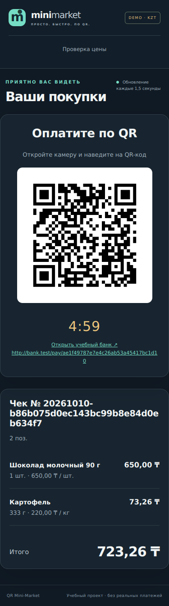

# Протокол проверки QR Mini-Market

Проверено 10 октября 2026 года в Linux, Python 3.12.14.

## Общий прогон

```text
414 passed, 14 warnings in 41.08s
Required test coverage of 80% reached. Total coverage: 95.46%
Ruff: All checks passed!
Ruff format: all files already formatted
pip check: No broken requirements found.
```

Команда:

```bash
.venv/bin/python -m pytest -q --cov=app.services --cov=mock_bank.service --cov=mock_bank.notifier --cov-report=term-missing --cov-fail-under=80
```

| Модуль | Покрытие строк |
| --- | ---: |
| `app/services/auth.py` | 94.96% |
| `app/services/catalog.py` | 98.95% |
| `app/services/orders.py` | 98.73% |
| `app/services/payments.py` | 89.07% |
| `app/services/qr_service.py` | 92.86% |
| `app/services/reports.py` | 100.00% |
| `mock_bank/notifier.py` | 98.39% |
| `mock_bank/service.py` | 99.13% |

14 предупреждений исходят из интеграции Starlette TestClient с httpx и передачи timeout в TestClient. Предупреждения не отключены. Требуемый ТЗ httpx сохранён.

## Два настоящих сервера

Выполнена команда `.venv/bin/python tests/e2e/smoke_tcp.py`. Сценарий создаёт временные БД и секреты, запускает два отдельных Uvicorn-процесса и общается с ними по TCP:

```text
Migration, idempotent seeds, and generated admin: OK
Real TCP: 3 piece products + weighted item + QR + signed webhook + PAID: OK
Real TCP: insufficient funds + webhook + order reopened: OK
Real TCP: background expiry + reserve released + public pages: OK
Both Uvicorn processes stopped cleanly; temporary databases removed: OK
```

Проверены фактические списания товара и баланса, снятие резерва, приём подписанного уведомления, отказ при недостатке денег, настоящее фоновое истечение счёта и штатная остановка. Этот subprocess-сценарий запускался в Linux.

## Проверка в настоящем браузере

Headless Chromium 133 + Playwright: выполнены вход с cookie, создание чека, скан штучного товара, ввод 333 г картофеля, итог 723,26 ₸, checkout и загрузка PNG QR. После подтверждения через FakeProvider касса и публичный экран показали PAID; открыты печатный чек, продажи, низкие остатки, разбор платежей и публичный поиск по EAN.

Ошибок JavaScript не было. Проверены ширины 1440 и 375 пикселей; горизонтальный выход длинного номера чека исправлен. На мобильном экране QR не меньше 300 пикселей. Браузерная проверка использовала FakeProvider; настоящий Mock Bank отдельно проверен сквозными HTTP-тестами и двумя Uvicorn-процессами выше.

Пример мобильного экрана из проверочного сценария (ссылка ведёт на тестовый провайдер):



## Остальные проверки

- Alembic: upgrade head, соответствие metadata, downgrade base и повторный upgrade; откат DDL атомарен. Head: `0002_commerce`.
- SQL миграций PostgreSQL скомпилирован offline; живого PostgreSQL-сервера не было.
- `node --check` для shop.js, bank.js и money.js; Node-тест точного форматирования сумм вплоть до int64 прошёл.
- Docker: shell-синтаксис entrypoint, структура YAML, Python healthchecks, порядок миграции/seed/запуска и остановка при ошибке. Docker отсутствует, сборка и запуск образа не выполнялись.
- Защита API: роли, JWT, Secure-cookie, CSRF, Origin, подписи, повторы, отсутствие внутренних ID и точных остатков в публичном каталоге.
- Конкурентность: последняя единица товара, повторный checkout, два банковских списания, оплата против отмены, два обработчика webhook и атомарный rollback.
- Windows и macOS не запускались; для них подготовлены команды в README.

## Финальный чек-лист ревью

- [x] Два сервиса с отдельными БД и без взаимных импортов.
- [x] Деньги и вес рассчитываются сервером в целых числах; UI форматирует BigInt.
- [x] Полный каталог, касса, QR, банк, чек, админка, роли и отчёты.
- [x] Снимки цен и журнал движения товара; резерв атомарен.
- [x] Неопределённый результат банка сохраняет резерв до сверки.
- [x] Подписанные события и итог продажи сохраняются атомарно; дубликаты безопасны.
- [x] Миграции и идемпотентные seed; пароли вводятся интерактивно.
- [x] Все тесты прошли, покрытие выше 80%, Ruff чистый.
- [x] Docker-конфигурация и инструкции запуска включены.
- [x] Ограничения и невыполненные платформенные проверки указаны явно.
